> 이 문서는 영문 [README.md](../../README.md)의 번역본입니다. 내용이 다르면 영문이 기준입니다.

  

<h1 align="center">⚡ LazyVerilog</h1>

  <b>RTL 코딩을 위한 빠르고 실용적인 SystemVerilog LSP.</b>

  
  

  
  
  
  

  <a href="../../README.md">English</a>
  ·
  <b>한국어</b>

  <a href="#-데모">데모</a>
  ·
  <a href="#️-비교">비교</a>
  ·
  <a href="#-기능">기능</a>
  ·
  <a href="#-시작하기">시작하기</a>

  LazyVerilog는 C++로 작성된 SystemVerilog LSP이며 neovim과 vscode를 지원합니다.
  실제 SystemVerilog 프로젝트를 대상으로 포매팅, 린팅, 코드 탐색, hover, 자동 완성, inlay hint, RTL code action을 제공합니다.

  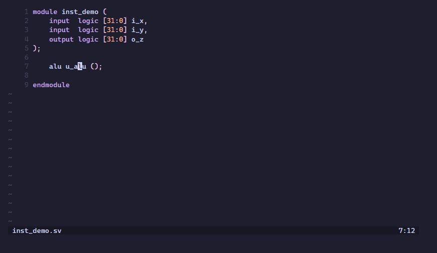

  LazyVerilog가 시간을 아껴 주었다면 ⭐ 하나가 다른 RTL 엔지니어들이 찾는 데 도움이 됩니다.

&nbsp;

## 🎬 데모

<b>🎨 포매팅</b>

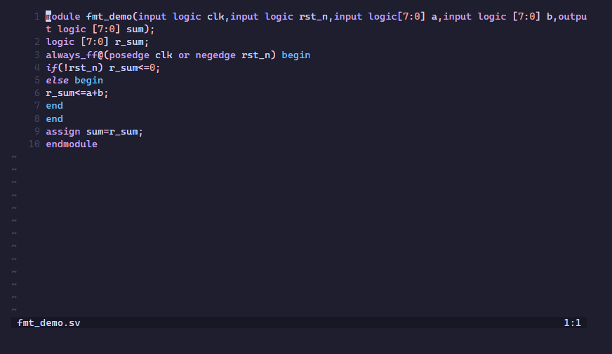

<b>🚨 Lint 진단</b>

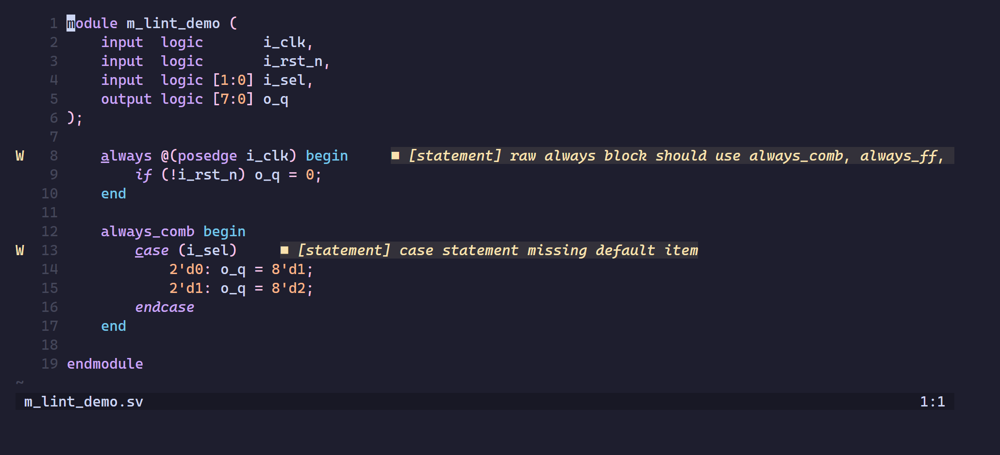

<b>⚡ 자동 완성</b>

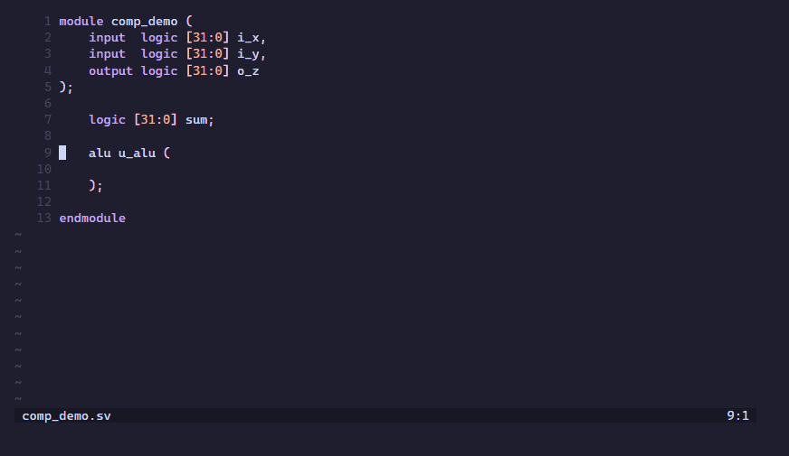

<b>🌳 RTL 트리</b>

<b>📂 코드 접기</b>

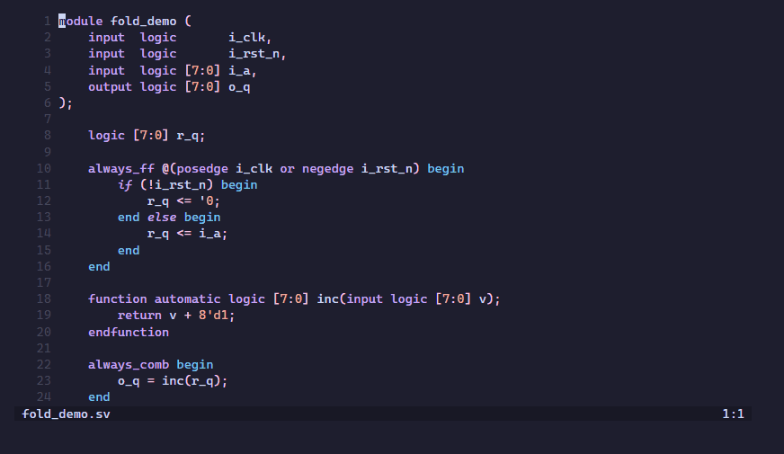

<b>🧭 정의로 이동</b>

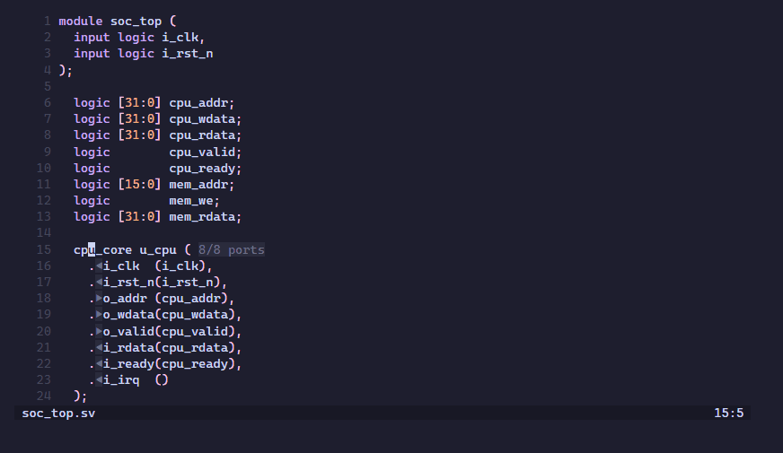

<b>🔗 인터페이스 연결</b>

<b>🧩 자동 인스턴스화</b>

<b>🔌 Auto-wire</b>

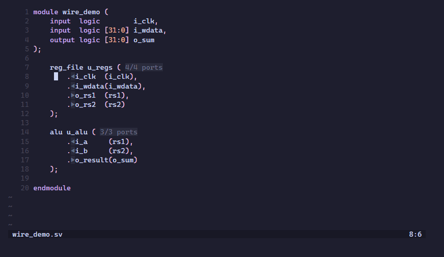

<b>🛠️ Auto-arg</b>

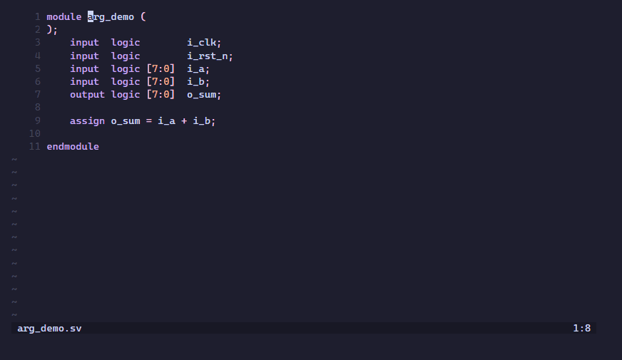

<b>💡 Hover</b>

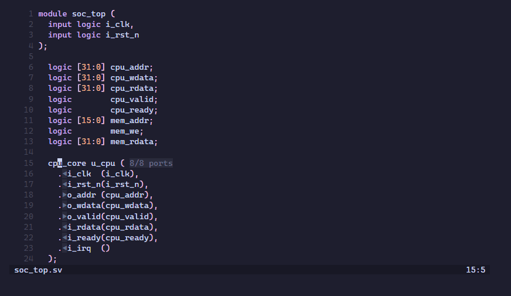

<b>💬 Inlay hint</b>

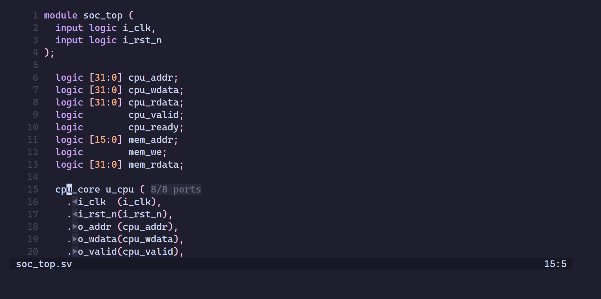

<b>🔍 참조 찾기</b>

<b>✏️ 이름 변경</b>

<b>🔭 워크스페이스 심볼</b>

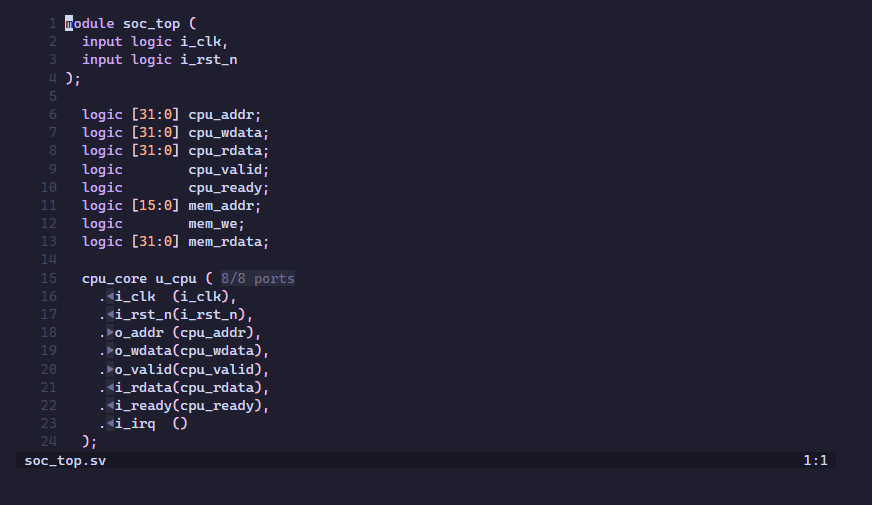

<b>📝 시그니처 도움말</b>

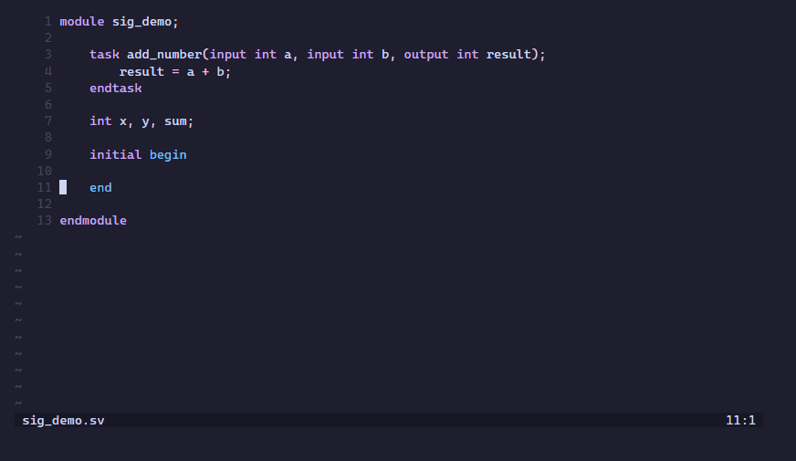

&nbsp;

## ⚖️ 비교

LazyVerilog와 가장 널리 쓰이는 두 오픈소스 SystemVerilog LSP인
[`verible`](https://github.com/chipsalliance/verible/blob/master/verible/verilog/tools/ls/README.md)
및 [`svlangserver`](https://github.com/imc-trading/svlangserver)의 비교입니다.

| | ⚡ LazyVerilog | Verible LS | svlangserver |
|---|---|---|---|
| UVM, class, package | ✅ | ⚠️ | ❌ |
| 런타임 | C++ | C++ | Node.js |
| 파서 | slang | Verible | 자체 인덱서 |
| 진단 | 파싱, lint, 시맨틱 | 파싱, lint | Verilator |
| 포매팅 | ✅ | ✅ | Verible 사용 |
| 정의로 이동 | ✅ | ✅ | ✅ |
| 참조 찾기 | ✅ | ✅ | ❌ |
| 이름 변경 | ✅ | ❌ | ❌ |
| Hover | ✅ | ⚠️ | ✅ |
| 자동 완성 | ✅ | ❌ | ✅ |
| 시그니처 도움말 | ✅ | ❌ | ✅ |
| Inlay hint | ✅ | ❌ | ❌ |
| 심볼 | ✅ | ✅ | ✅ |
| Lint 자동 수정 | ⚠️ | ✅ | ❌ |
| RTL 코드 생성 | ✅ | ❌ | ❌ |
| RTL 계층 뷰 | ✅ | ❌ | ✅ |
| 인터페이스 / 연결 | ✅ | ❌ | ❌ |

⚠️는 일부 지원 또는 실험적 기능입니다.

&nbsp;

## 📊 기능

LazyVerilog가 현재 지원하는 기능:

| 기능 | 상태 | 비고 |
|---------|--------|-------|
| 포매팅 | ✅ | `lazyverilog.toml`로 설정 |
| Lint 진단 | ✅ | 파싱 진단, 선택적 시맨틱 진단, 설정 가능한 lint/스타일 규칙 |
| Lint quick fix | ⚠️ | 빠진 `default` 추가, `automatic` lifetime 추가 |
| 정의로 이동 | ✅ | 모듈, 인스턴스, 포트, 이름 지정 인자, 심볼, 매크로 |
| 참조 찾기 | ✅ | 열린 파일과 프로젝트 파일 전체의 심볼과 매크로 |
| 심볼 이름 변경 | ✅ | 프로젝트 파일 전체에 걸쳐 최선 노력 방식 |
| Hover | ✅ | 모듈, 포트, 신호, 파라미터, typedef, 서브루틴, 매크로의 정보 |
| 자동 완성 | ✅ | 문맥을 인식하는 자동 완성 |
| 시그니처 도움말 | ✅ | 함수와 태스크 |
| Inlay hint | ✅ | 인스턴스의 포트 방향 |
| 문서 심볼 | ✅ | 현재 파일의 아웃라인 |
| 워크스페이스 심볼 | ✅ | 모듈, 인터페이스, 패키지, class와 method, 함수, 태스크, typedef, `pkg::name` 검색 |
| RTL 트리 | ✅ | 모듈 인스턴스 계층 |
| 자동 인스턴스화 / Auto-wire / Auto-arg / Auto-function / Auto-FF | ✅ | RTL 생성을 위한 여러 Code Action |
| 프로젝트별 설정 | ✅ | 프로젝트의 `lazyverilog.toml`로 설정 |

&nbsp;

## 🚀 시작하기

Neovim과 VS Code의 설치, 사용법, 설정: **https://lazyverilog.github.io** (영문)
