> Esta é uma tradução automática gerada pelo Claude. A versão em inglês ([README.md](../../README.md)) é a referência oficial.

  

<h1 align="center">⚡ LazyVerilog</h1>

  <b>Um LSP de SystemVerilog rápido e prático para codificação de RTL.</b>

  
  

  
  
  
  

  <b>English</b>
  ·
  <a href="../../docs/i18n/README.ko.md">한국어</a>

  <a href="#-demonstração">Demonstração</a>
  ·
  <a href="#-comparação">Comparação</a>
  ·
  <a href="#-funcionalidades">Funcionalidades</a>
  ·
  <a href="#-primeiros-passos">Primeiros passos</a>

  O LazyVerilog é um LSP de SystemVerilog escrito em C++ com suporte a neovim e vscode.
  Ele oferece formatação, linting, navegação, hover, autocompletar, inlay hints e code actions de RTL para projetos SystemVerilog reais.

  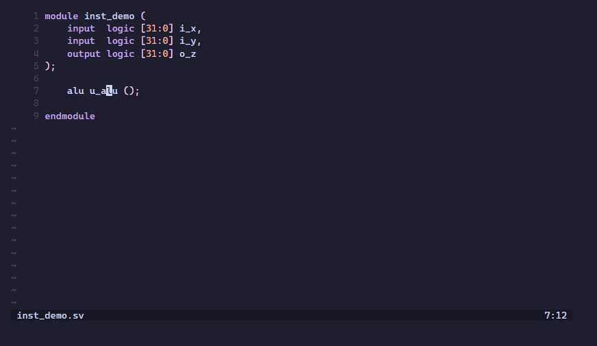

  Se o LazyVerilog economiza seu tempo, uma ⭐ ajuda outros engenheiros de RTL a encontrá-lo.

&nbsp;

## 🎬 Demonstração

<b>🎨 Formatação</b>

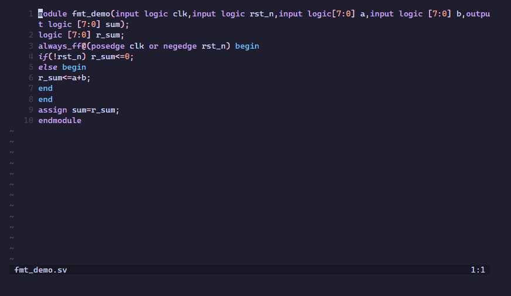

<b>🚨 Diagnósticos de lint</b>

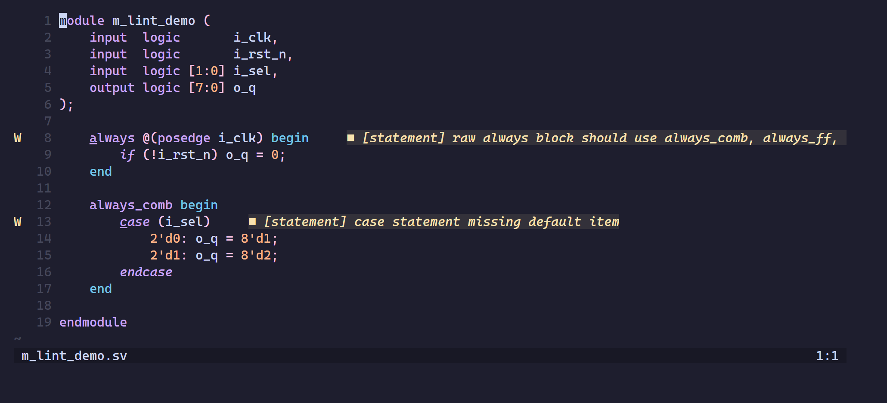

<b>⚡ Autocompletar</b>

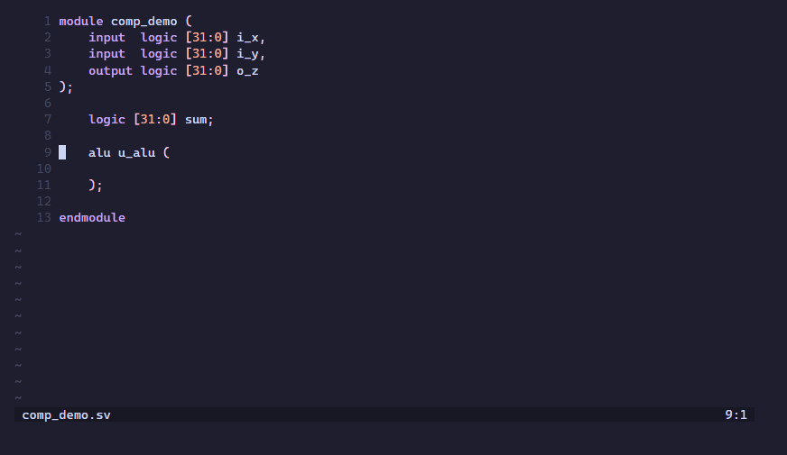

<b>🌳 Árvore de RTL</b>

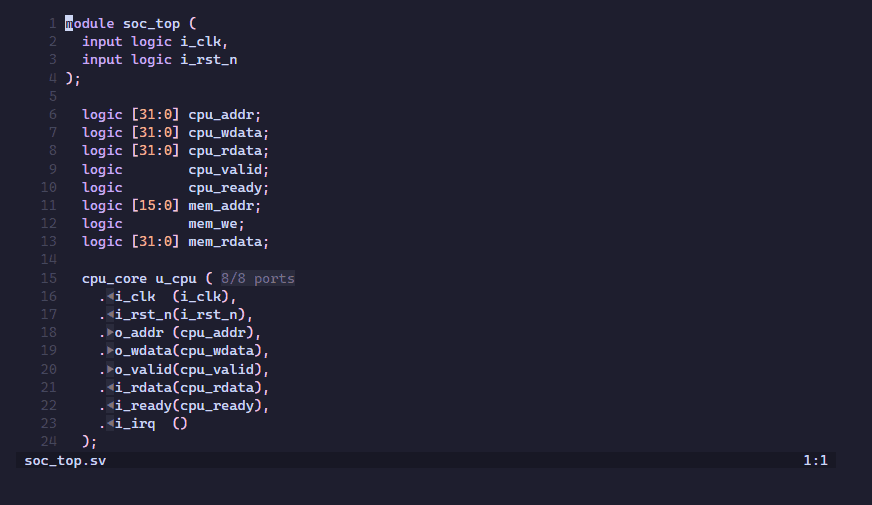

<b>📂 Folding</b>

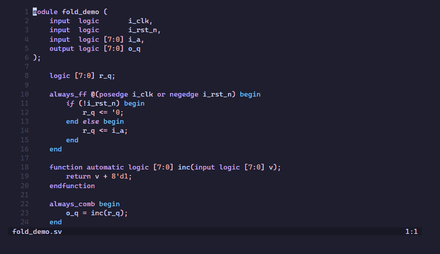

<b>🧭 Ir para a definição</b>

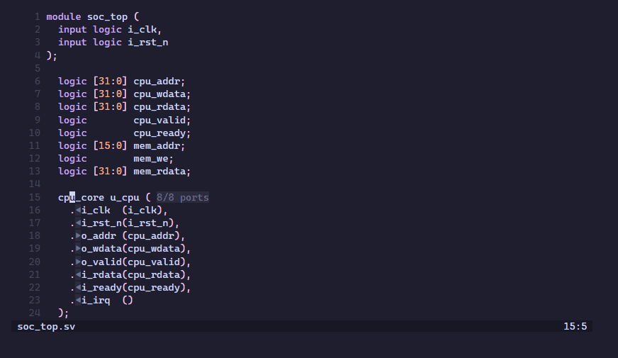

<b>🔗 Conexão de interface</b>

<b>🧩 Auto-instanciação</b>

<b>🔌 Auto-wire</b>

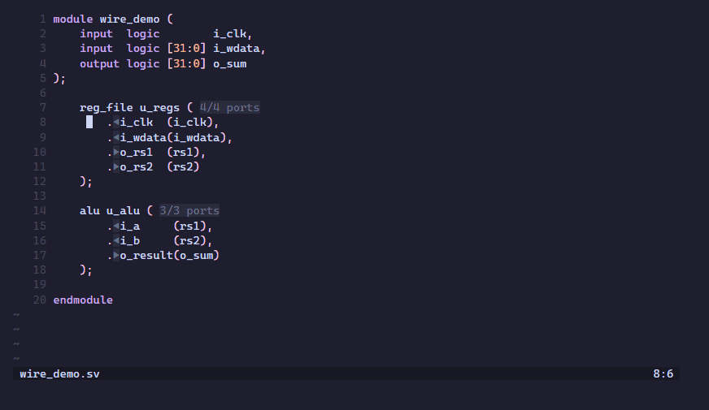

<b>🛠️ Auto-arg</b>

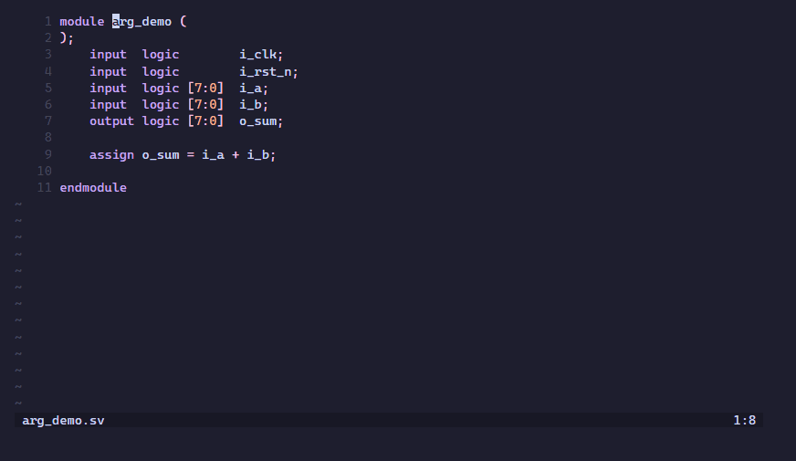

<b>💡 Hover</b>

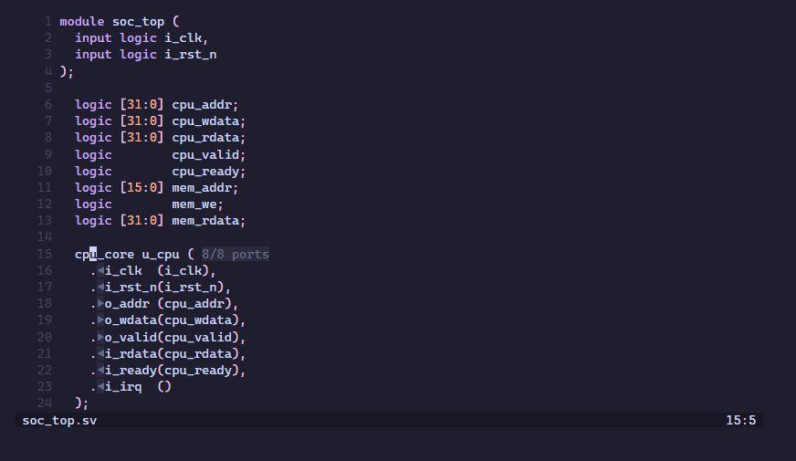

<b>💬 Inlay hints</b>

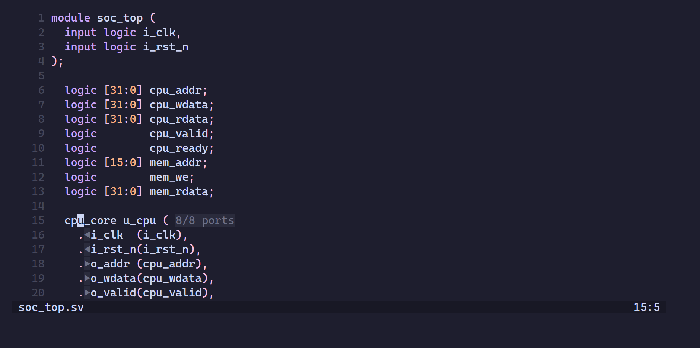

<b>🔍 Localizar referências</b>

<b>✏️ Renomear</b>

<b>🔭 Símbolos do workspace</b>

<b>📝 Ajuda de assinatura</b>

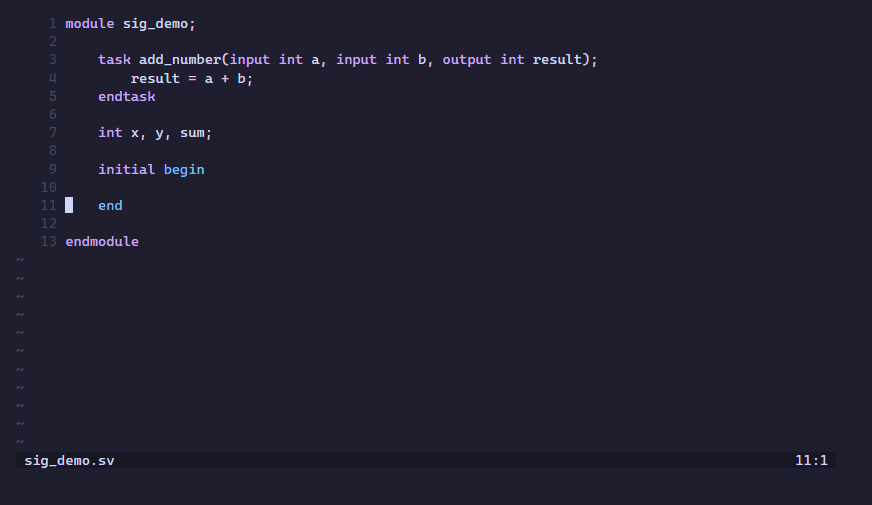

&nbsp;

## ⚖️ Comparação

Comparação entre o LazyVerilog e os dois LSP de SystemVerilog open-source mais utilizados:
[`verible`](https://github.com/chipsalliance/verible/blob/master/verible/verilog/tools/ls/README.md)
 e [`svlangserver`](https://github.com/imc-trading/svlangserver).

| | ⚡ LazyVerilog | Verible LS | svlangserver |
|---|---|---|---|
| UVM, classes, packages | ✅ | ⚠️ | ❌ |
| Runtime | C++ | C++ | Node.js |
| Parser | slang | Verible | indexador próprio |
| Diagnósticos | parse, lint, semântico | parse, lint | Verilator |
| Formatação | ✅ | ✅ | via Verible |
| Ir para a definição | ✅ | ✅ | ✅ |
| Localizar referências | ✅ | ✅ | ❌ |
| Renomear | ✅ | ❌ | ❌ |
| Hover | ✅ | ⚠️ | ✅ |
| Autocompletar | ✅ | ❌ | ✅ |
| Ajuda de assinatura | ✅ | ❌ | ✅ |
| Inlay hints | ✅ | ❌ | ❌ |
| Símbolos | ✅ | ✅ | ✅ |
| Autofix de lint | ✅ (`--fix`) | ✅ | ❌ |
| Geração de código RTL | ✅ | ❌ | ❌ |
| Visualização da hierarquia de RTL | ✅ | ❌ | ✅ |
| Interface e conexão | ✅ | ❌ | ❌ |

⚠️ indica suporte parcial ou experimental.

&nbsp;

## 📊 Funcionalidades

O que o LazyVerilog suporta atualmente:

| Funcionalidade | Status | Observações |
|---------|--------|-------|
| Formatação | ✅ | Configurável via `lazyverilog.toml` |
| Diagnósticos de lint | ✅ | Diagnósticos de parse, diagnósticos semânticos opcionais e regras de lint/estilo configuráveis |
| Quick fixes de lint | ⚠️ | Adicionar um `default` ausente, adicionar um lifetime `automatic` |
| Ir para a definição | ✅ | Módulos, instâncias, portas, argumentos nomeados, símbolos e macros |
| Localizar referências | ✅ | Símbolos e macros nos arquivos abertos e nos arquivos de projeto configurados |
| Renomear símbolo | ✅ | Melhor esforço em todos os arquivos do projeto |
| Hover | ✅ | Detalhes de símbolos para módulos, portas, sinais, parâmetros, typedefs, subrotinas e macros |
| Autocompletar | ✅ | Sugestões sensíveis ao contexto |
| Ajuda de assinatura | ✅ | Funções e tasks |
| Inlay hints | ✅ | Direção das portas na instanciação |
| Símbolos do documento | ✅ | Outline do arquivo atual |
| Símbolos do workspace | ✅ | Módulos, interfaces, packages, classes e métodos; funções, tasks e typedefs; consultas `pkg::name` |
| Árvore de RTL | ✅ | Hierarquia de instanciação de módulos |
| Auto-instanciação / Auto-wire / Auto-arg / Auto-function / Auto-FF | ✅ | Diversas Code Actions para geração de RTL |
| Configuração local do projeto | ✅ | Personalização completa por meio do `lazyverilog.toml` na raiz do projeto |

&nbsp;

## 🚀 Primeiros Passos

Instalação, uso e configuração para Neovim e VS Code: **https://lazyverilog.github.io**
